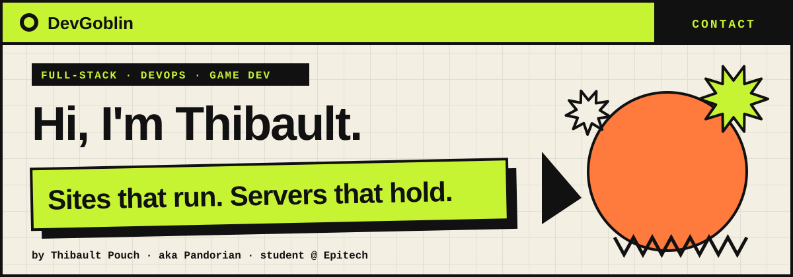
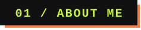
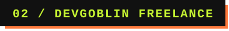
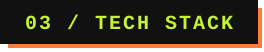
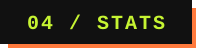
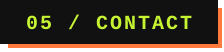

Fourth-year student at **Epitech** (Grande Ecole programme), passionate about software development and technological innovation.

I work on the whole chain, from the interface to the server that hosts it. I like self-hosted, CLI-first tooling, clean architecture and documentation that explains *why*, not only *what*.

I'm part of **CrowMate**, a team of Epitech classmates building a game and its web ecosystem. When I'm not coding, I'm behind a lens capturing moments.

**Sites that run. Servers that hold.** I take on freelance missions under the **DevGoblin** brand, from Barcelona or remotely:

- **Websites and web apps**: showcase sites, intranets, e-commerce customisation
- **Architecture and DevOps**: servers, Docker, CI/CD, self-hosting
- **A bit of mobile**: PWA

**Languages**

**Frontend and backend**

**Infrastructure and DevOps**

**Tools**

  
  
   
  

Open for a collaboration, a mission, or just to talk tech.

`by Thibault Pouch, full-stack & DevOps developer`

